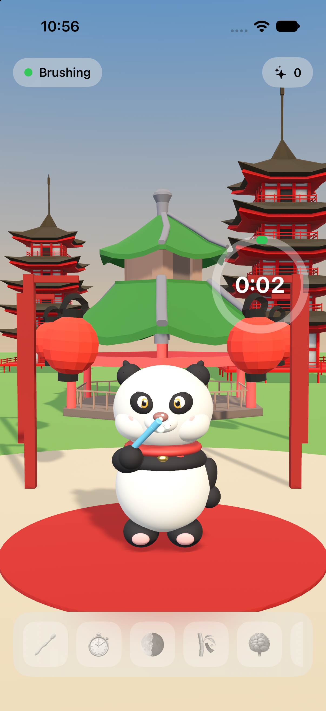

# BrushWatch

A kids' brushing game for iPhone. Bao, our own panda, stands in a 3D Chinese temple courtyard, reacts to a real Philips Sonicare toothbrush over Bluetooth LE and earns achievements for good brushing.



## How it works

- **Brush detection.** The app stays connected to the selected brush and reads its handle state (`…4010`), brushing state (`…4082`) and brushing time (`…4090`). It counts as brushing when the handle state is *run* or the brushing state is *on*. The Sonicare map comes from community reverse engineering ([mtheli/philips_sonicare_ble](https://github.com/mtheli/philips_sonicare_ble)). The newer "Condor" protocol brushes (Kids HX6600, Series 7100) aren't supported yet, and the app says so.
- **3D scene.** Built with RealityKit + SwiftUI (`RealityView`, virtual camera). `PandaDirector` cuts Bao's clips from his single USDZ timeline: Idle, Wave, Brush (looped while brushing, with toothpaste foam), Jump (achievements), Yes (session done) and Giggle (on tap).
- **Achievements.** `Achievements.swift` defines first brush, 2 minutes, morning + evening, 3- and 7-day streaks, 10 sessions and 30 sessions. Sessions under 10 s are ignored. Progress is saved in UserDefaults.

## Run it

```bash
xcodegen generate
open BrushWatch.xcodeproj     # pick your iPhone, ⌘R
```

Tap the status pill (top left) to pick your brush, and close the Philips app first. The **Simulate brushing** switch in that sheet drives the panda without a brush. Launching with the `-simulateBrushing` argument starts a fake session automatically.

## Models

| Model | Author | License |
|---|---|---|
| Bao (the panda) | original, built by `tools/build_panda.py` | ours |
| Pavilion, Pagoda | Poly by Google | CC-BY 3.0 |
| Red Lantern | Sophie Kim | CC-BY 3.0 |

All were downloaded from poly.pizza as GLB and converted to USDZ with `tools/convert.py`. The script also scales each model to real-world metres and lays out the chosen animations end to end:

```bash
blender -b --python tools/convert.py -- panda.glb BrushWatch/Models/Panda.usdz 1.0 Idle Wave Yes Jump Chop_Loop Punch
```

If you change the panda's clip list, copy the printed frame ranges into `PandaDirector.ranges`.

## Bao, the panda

Bao is generated in code: smooth shapes on pivot empties, keyframed in Blender, then baked to a skeleton, because RealityKit only plays skeletal animation from USD. To rebuild him and render previews:

```bash
blender -b --factory-startup --python tools/build_panda.py -- BrushWatch/Models/Bao.usdz /tmp/bao-previews
```

If you change any clip lengths, copy the printed `CLIPS` frame ranges into `PandaDirector.ranges`.
